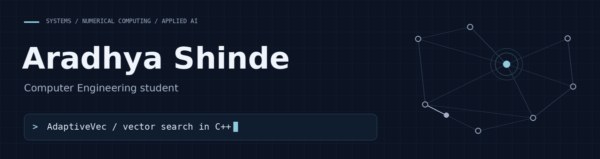

  

  <a href="https://aradhyags7.github.io/Portfolio/">Portfolio</a> &nbsp;·&nbsp;
  <a href="https://www.linkedin.com/in/aradhya-shinde-5797b8304">LinkedIn</a> &nbsp;·&nbsp;
  <a href="mailto:aradhyashinde2330@gmail.com">Email</a>

I'm a **Computer Engineering student** working on systems, numerical computing, and applied AI. I build C++ search and caching experiments, Python desktop tools, and encrypted communication apps.

### Selected work

<table>
  <tr>
    <td width="50%" valign="top">
      <h3><a href="https://github.com/aradhyags7/AdaptiveVec">AdaptiveVec</a></h3>
      
A vector search index with graph connectivity adapted to local density and dimensionality. Includes AVX2 distance kernels, mixed precision storage, and reproducible benchmark tooling.

      
<code>C++17</code> <code>Python</code> <code>HNSW</code>

    </td>
    <td width="50%" valign="top">
      <h3><a href="https://github.com/aradhyags7/AdaMem-FDE">AdaMem-FDE</a></h3>
      
Adaptive memory compression for neural fractional differential equations. Includes sum-of-exponentials solvers and a custom PyTorch adjoint that accounts for changes in the memory representation.

      
<code>Python</code> <code>PyTorch</code> <code>Numerical methods</code>

    </td>
  </tr>
  <tr>
    <td width="50%" valign="top">
      <h3><a href="https://github.com/aradhyags7/PromptCache">PromptCache</a></h3>
      
A prompt-response caching simulator comparing FIFO, LRU, LFU, GDSF, and a phase-aware adaptive policy. Includes workload generation, semantic reuse experiments, and a web visualizer.

      
<code>C++20</code> <code>Data structures</code> <code>Simulation</code>

    </td>
    <td width="50%" valign="top">
      <h3><a href="https://github.com/aradhyags7/TwoOfUs">TwoOfUs</a></h3>
      
A private communication app for two people, with encrypted messages and media, WebRTC calls, and two-factor authentication. Uses X25519 key exchange and AES-256-GCM encryption.

      
<code>Flutter</code> <code>FastAPI</code> <code>PostgreSQL</code>

    </td>
  </tr>
  <tr>
    <td width="50%" valign="top">
      <h3><a href="https://github.com/aradhyags7/SONICBULK">SONICBULK</a></h3>
      
A desktop and CLI tool that turns PDF, DOCX, CSV, and text tracklists into an audio library. Includes track matching, a concurrent download pipeline, and metadata tagging.

      
<code>Python</code> <code>PySide6</code> <code>asyncio</code>

    </td>
    <td width="50%" valign="top">
      <h3><a href="https://github.com/aradhyags7/Aegis">Aegis</a></h3>
      
A desktop voice assistant using Ollama for local inference and Faster-Whisper for transcription. Includes Windows automation, hardware telemetry, and web search for current information.

      
<code>Electron</code> <code>React</code> <code>FastAPI</code>

    </td>
  </tr>
</table>

### Tools I use

**Systems & computing** &nbsp; C++ · Python · CMake · NumPy · PyTorch 
**Apps & APIs** &nbsp; Dart · Flutter · TypeScript · React · FastAPI 
**Data & development** &nbsp; PostgreSQL · SQLite · Git · Docker · Linux

  <a href="https://github.com/aradhyags7?tab=repositories">More projects</a> &nbsp;·&nbsp;
  <a href="https://aradhyags7.github.io/Portfolio/">Explore my interactive portfolio</a>

